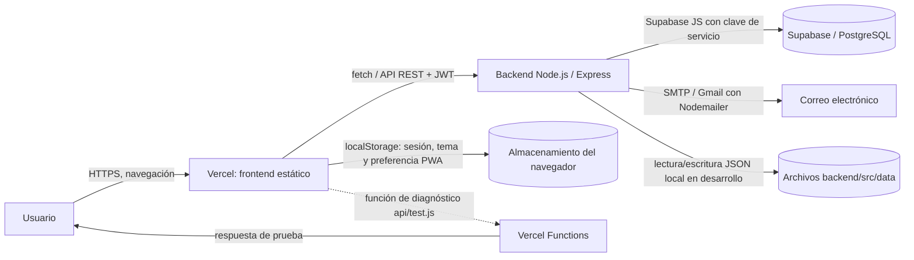

# Arquitectura

## Componentes y relaciones

- **Frontend:** React con TypeScript, Vite, React Router y Tailwind CSS; sus servicios llaman al backend con `fetch` y envían el JWT en `Authorization: Bearer`. El paquete está configurado como PWA.
- **Backend:** API Express en `IntraNet/backend/src/index.js`, desplegable también mediante `IntraNet/backend/api/index.js`. Comprueba JWT, aplica middlewares de seguridad y delega operaciones en servicios.
- **Supabase/PostgreSQL:** el backend usa `@supabase/supabase-js` y `SUPABASE_SERVICE_KEY`. Las consultas de negocio se ejecutan principalmente sobre PostgreSQL. Aunque el frontend incluye cliente Supabase, no se confirma desde la configuración revisada que se use directamente para datos de negocio.
- **Correo:** Nodemailer envía todas las notificaciones de solicitudes al destinatario definido en `EMAIL_RECIBIDOS` (admite varias direcciones separadas por coma). La recuperación de contraseña usa un transporte SMTP separado configurado mediante `SMTP_*`.
- **Vercel:** se encuentran handlers en `backend/api/index.js` y `backend/api/test.js`, compatibles con funciones serverless. **No verificado:** el repositorio no incluye `vercel.json`, proyecto vinculado ni evidencia de que el deploy activo esté en Vercel.
- **Almacenamiento local:** el navegador persiste token y datos de sesión, tema y aviso de instalación PWA. En desarrollo, el backend guarda bloqueos de login y logs de actividad en JSON. Esos dos mecanismos del backend se desactivan cuando `VERCEL=1`.
- **Archivos adjuntos:** el frontend lee imágenes y PDF como Data URL; se guardan como URL o contenido referenciado desde campos de negocio. **No verificado:** no se encontró una configuración de bucket de Supabase Storage ni un proveedor de archivos confirmado.

## Flechas del diagrama

1. Usuario → Vercel: carga la aplicación web por navegación HTTPS.
2. Vercel → Backend: las páginas consumen endpoints REST; las peticiones autenticadas llevan el JWT.
3. Backend → PostgreSQL: servicios consultan y modifican tablas mediante el SDK de Supabase.
4. Backend → correo: los servicios de solicitudes y recuperación envían mensajes a destinatarios configurados.
5. Frontend → almacenamiento del navegador: el cliente persiste sesión y preferencias localmente.
6. Backend → archivos JSON: solo para mecanismos locales auxiliares fuera de Vercel.
7. Vercel Functions → usuario: endpoint de diagnóstico de despliegue que responde un JSON fijo; no implementa el flujo de negocio.

Los nombres de variables de entorno y la configuración de persistencia se detallan en el código (`backend/.env.example`, `config/validateEnv.js` y `fakeDb/`). Los planes comerciales no se desprenden del código; ver [propuesta comercial](propuesta-comercial.md).
