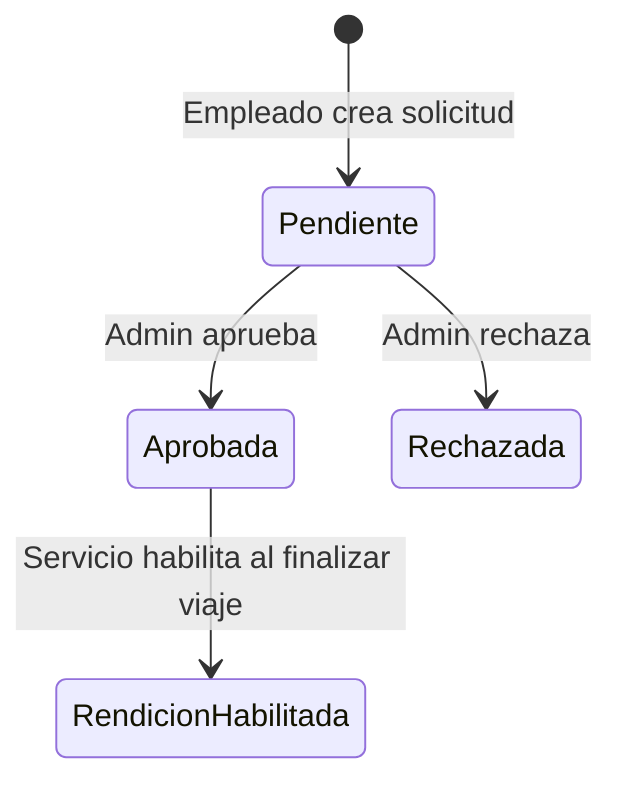
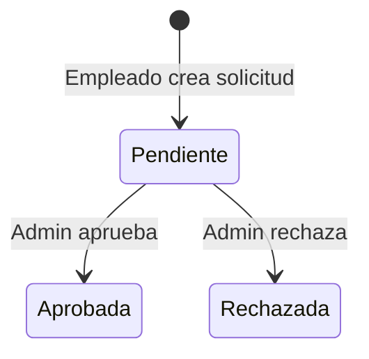
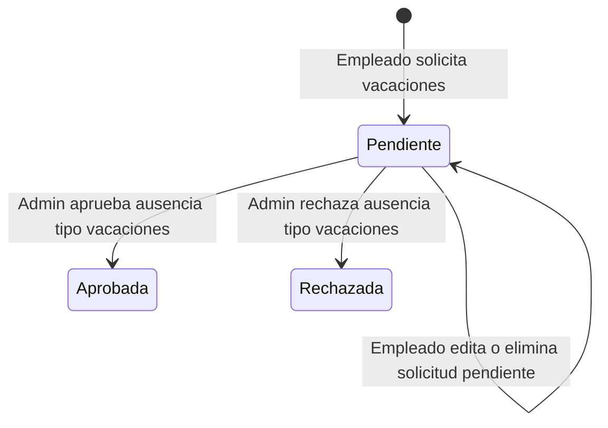
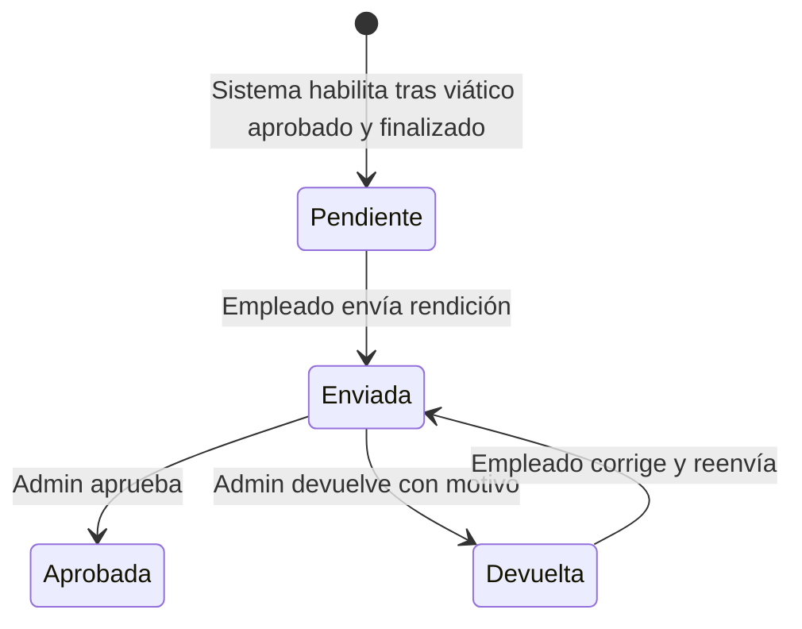

# Flujo de estados

Los diagramas reflejan las transiciones implementadas por servicios y rutas. En solicitudes generales, `admin` es el único rol backend habilitado para resolverlas; el usuario autenticado no administrador las crea. Las transiciones no descritas como acción de usuario no se presuponen.

## Viáticos

La solicitud de viático usa `viaticos.estado`. Al aprobarse y cumplirse la condición de finalización, el servicio sincroniza/crea una rendición. No se confirma una transición automática de viático a estado `enviada`.

## Adelantos

El backend acepta al resolver `aprobada` o `rechazada`; el servicio no permite resolver de nuevo como `pendiente`.

## Vacaciones

Vacaciones no tiene tabla de solicitudes separada: se persiste en `ausencias` con tipo `Vacaciones`/`vacacion`. Al aprobar una ausencia, `ausencias.service.js` actualiza `vacaciones_saldo`. Si no existe registro previo, el servicio crea uno con el valor asignado por defecto.

## Rendiciones

Los endpoints son `PUT /rendiciones/:id/enviar`, `/aprobar` y `/devolver`. El rechazo no aparece como estado final de rendición; el servicio traduce la decisión no aprobatoria a `devuelta`. El permiso de edición/envío respeta la propiedad de la rendición y el rol admin. La transición de reenvío se refleja en el servicio; **No verificado:** si todas las condiciones de negocio requeridas para cada tipo de gasto coinciden con una política institucional aprobada.
