# Modelo de datos

El diagrama resume columnas principales, claves y relaciones declaradas en `supabase/estructura.sql`. Se incorporan también la tabla y columnas de recuperación definidas en `supabase/migrations/20261104_password_recovery.sql`. No se infieren relaciones donde el SQL no declara una clave foránea.

```mermaid
erDiagram
  empleados {
    bigint id PK
    text legajo
    text nombre
    text apellido
    text email_corporativo
    text role
    boolean activo
    text password_hash
  }
  sectores {
    int id PK
    text nombre
    boolean activo
  }
  adelantos {
    bigint id PK
    bigint empleado_id FK
    numeric monto
    text empresa
    text estado
    bigint resuelto_por FK
  }
  ausencias {
    bigint id PK
    bigint empleado_id FK
    text tipo
    date fecha_desde
    date fecha_hasta
    text estado
    text archivo_url
  }
  vacaciones_saldo {
    bigint empleado_id PK
    int anio PK
    int dias_asignados
    int dias_usados
  }
  solicitudes {
    bigint id PK
    bigint empleado_id FK
    text tipo
    text estado
    date fecha_desde
    date fecha_hasta
    bigint resuelto_por FK
    uuid grupo_id
  }
  viaticos {
    bigint id PK
    bigint empleado_id FK
    date fecha_necesaria
    numeric monto
    text estado
    text destino_viaje
  }
  viaticos_rendiciones {
    bigint id PK
    bigint viatico_id FK
    bigint empleado_id FK
    text estado
    numeric total_gastos
    bigint enviado_por FK
    bigint aprobado_por FK
    bigint devuelto_por FK
  }
  viaticos_rendiciones_gastos {
    bigint id PK
    bigint rendicion_id FK
    date fecha
    text concepto
    numeric importe
    text comprobante_url
  }
  reservas_hotel {
    bigint id PK
    bigint empleado_id FK
    text ciudad
    date fecha_desde
    date fecha_hasta
    text estado
  }
  reservas_vehiculos {
    bigint id PK
    bigint empleado_id FK
    bigint vehiculo_id FK
    date fecha_desde
    date fecha_hasta
    text destino
    text estado
  }
  vehiculos {
    bigint id PK
    text patente
    text marca
    text modelo
    boolean disponible
  }
  technical_supply_requests {
    bigint id PK
    bigint empleado_id FK
    text email
    numeric amount
    text status
    bigint resolved_by FK
  }
  beneficios {
    bigint id PK
    text nombre
    boolean activo
    text enlace_url
  }
  eventos {
    bigint id PK
    text titulo
    timestamptz fecha_inicio
    bigint creado_por FK
    boolean activo
  }
  eventos_asistentes {
    bigint evento_id PK
    bigint empleado_id PK
    boolean confirmado
  }
  home_slider {
    uuid id PK
    text titulo
    text imagen_url
    int orden
    boolean activo
  }
  manuales {
    bigint id PK
    text titulo
    text categoria
    text archivo_url
    boolean activo
  }
  mensajes {
    bigint id PK
    bigint remitente_id FK
    bigint destinatario_id FK
    text asunto
    text cuerpo
    boolean leido
  }
  notificaciones {
    bigint id PK
    bigint empleado_id FK
    text titulo
    boolean leida
  }
  novedades {
    bigint id PK
    text titulo
    bigint publicado_por FK
    boolean activo
    jsonb sucursales_destino
  }
  novedades_comentarios {
    bigint id PK
    bigint novedad_id FK
    bigint empleado_id FK
    text contenido
  }
  novedades_encuesta_votos {
    bigint id PK
    bigint novedad_id FK
    bigint empleado_id FK
    text opcion_id
  }
  novedades_likes {
    bigint novedad_id PK
    bigint empleado_id PK
  }
  politicas {
    bigint id PK
    text titulo
    text categoria
    boolean obligatoria
    boolean activo
  }
  politicas_lecturas {
    bigint politica_id PK
    bigint empleado_id PK
    timestamptz leida_at
  }
  recibos_sueldo {
    bigint id PK
    bigint empleado_id FK
    text periodo
    text archivo_url
  }
  sugerencias {
    bigint id PK
    bigint empleado_id FK
    text titulo
    text estado
  }
  sugerencias_votos {
    bigint sugerencia_id PK
    bigint empleado_id PK
  }
  password_recovery_requests {
    bigint id PK
    bigint empleado_id FK
    text email_hash
    text token_hash
    timestamptz expires_at
    timestamptz used_at
  }
  empleados ||--o{ adelantos : solicita
  empleados o|--o{ adelantos : resuelve
  empleados ||--o{ ausencias : solicita
  empleados ||--o{ vacaciones_saldo : acumula
  empleados ||--o{ solicitudes : crea
  empleados ||--o{ viaticos : solicita
  empleados ||--o{ viaticos_rendiciones : rinde
  viaticos ||--o{ viaticos_rendiciones : origina
  viaticos_rendiciones ||--o{ viaticos_rendiciones_gastos : contiene
  empleados ||--o{ reservas_hotel : solicita
  empleados ||--o{ reservas_vehiculos : solicita
  vehiculos o|--o{ reservas_vehiculos : asigna
  empleados ||--o{ technical_supply_requests : solicita
  eventos ||--o{ eventos_asistentes : registra
  empleados o|--o{ eventos : crea
  empleados ||--o{ eventos_asistentes : confirma
  empleados ||--o{ mensajes : remite
  empleados ||--o{ mensajes : recibe
  empleados ||--o{ notificaciones : recibe
  empleados o|--o{ novedades : publica
  novedades ||--o{ novedades_comentarios : recibe
  empleados ||--o{ novedades_comentarios : comenta
  novedades ||--o{ novedades_encuesta_votos : recibe
  empleados ||--o{ novedades_encuesta_votos : vota
  novedades ||--o{ novedades_likes : recibe
  empleados ||--o{ novedades_likes : marca
  politicas ||--o{ politicas_lecturas : registra
  empleados ||--o{ politicas_lecturas : lee
  empleados ||--o{ recibos_sueldo : recibe
  empleados ||--o{ sugerencias : propone
  sugerencias ||--o{ sugerencias_votos : recibe
  empleados ||--o{ sugerencias_votos : vota
  empleados o|--o{ solicitudes : resuelve
  empleados o|--o{ technical_supply_requests : resuelve
  empleados o|--o{ viaticos_rendiciones : envia
  empleados o|--o{ viaticos_rendiciones : aprueba
  empleados o|--o{ viaticos_rendiciones : devuelve
  empleados o|--o{ password_recovery_requests : solicita_recuperacion
```

## Entidades

| Entidad | Uso y campos representativos |
|---|---|
| `empleados` | Cuenta y ficha laboral: legajo, nombre, apellido, correos, sucursal, área, cargo, rol, estado activo, hash de contraseña y control de cambio obligatorio. La migración añade `must_change_password` y `credential_version`. |
| `sectores` | Catálogo de sectores: nombre y estado activo. |
| `adelantos` | Adelanto solicitado por empleado: importe, empresa, estado, comentario y resolución administrativa. |
| `ausencias` | Ausencias, llegadas tarde y vacaciones: tipo, rango de fechas, motivo, estado/aprobación y adjunto. Vacaciones se persisten dentro de esta tabla con tipo de ausencia. |
| `vacaciones_saldo` | Días asignados y usados por empleado y año. Si no hay fila, el servicio aplica un valor predeterminado de 14 días; consultar código de `vacaciones.service.js`. |
| `solicitudes` | Solicitudes generales: tipo, estado, fechas, destino, descripción, monto, justificación, resolución, grupo y datos adicionales JSON. |
| `viaticos` | Solicitud de viático: empleado y datos de viaje/importe, estado, información de contacto y adjunto. |
| `viaticos_rendiciones` | Rendición asociada al viático y empleado: estado, fechas de habilitación/envío/resolución, montos agregados y motivo de devolución. |
| `viaticos_rendiciones_gastos` | Ítems de gasto de una rendición: fecha, concepto, medio de pago, importe y referencia del comprobante. |
| `reservas_hotel` | Reserva de alojamiento: empleado, ciudad, fechas, motivo, estado y datos adicionales. |
| `reservas_vehiculos` | Reserva de vehículo: empleado, vehículo opcional, fechas, destino, motivo y estado. |
| `vehiculos` | Catálogo de unidades: patente, marca, modelo, capacidad y disponibilidad. |
| `technical_supply_requests` | Solicitudes de insumos técnicos: empleado, email, comentario, importe, estado y datos de resolución. |
| `beneficios` | Catálogo de beneficios con nombre, descripción, imagen, enlace y estado. |
| `eventos` | Eventos con título, fechas, lugar, autor, alcance por sucursales y recursos adjuntos. |
| `eventos_asistentes` | Confirmaciones de asistencia por evento y empleado. |
| `home_slider` | Elementos del slider institucional: título, imagen, enlace, orden y visibilidad. |
| `manuales` | Documentos internos con categoría, archivo, versión, páginas y visibilidad. |
| `mensajes` | Mensajería interna entre remitente y destinatario, con asunto, cuerpo y leído/no leído. |
| `notificaciones` | Avisos internos asociados a un empleado, con título, mensaje y leído/no leído. |
| `novedades` | Publicaciones del muro, autor, importancia, adjunto, encuesta y segmentación por sucursal. |
| `novedades_comentarios` | Comentarios vinculados a una novedad y empleado. |
| `novedades_encuesta_votos` | Opción votada por empleado en una encuesta publicada. |
| `novedades_likes` | Relación empleado-novedad para reacciones. |
| `politicas` | Políticas institucionales, categoría, versión, documento, obligatoriedad y visibilidad. |
| `politicas_lecturas` | Registro de lectura de una política por empleado. |
| `recibos_sueldo` | Referencia de recibo de sueldo por empleado y período. |
| `sugerencias` | Propuestas de empleados con título, descripción, categoría y estado. |
| `sugerencias_votos` | Votos asociados a empleado y sugerencia. |
| `password_recovery_requests` | Solicitudes de recuperación; almacena hashes de email/token, vencimiento, intentos, verificación y consumo. La relación a empleado permite nulo por diseño. |

El SQL declara algunas relaciones lógicas por columnas (por ejemplo, `solicitudes.resuelto_por`) sin constraint de clave foránea; el diagrama solo marca como FK las relaciones declaradas formalmente. El archivo `supabase/estructura.sql` es el esquema observado, pero **No verificado** que coincida con el esquema actualmente desplegado en Supabase.
